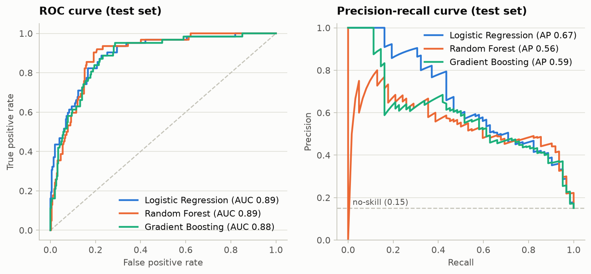
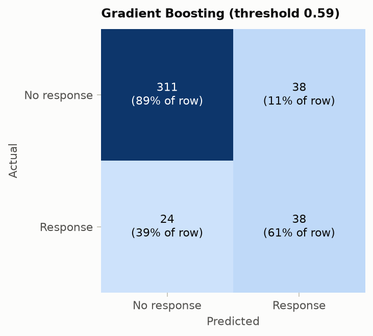
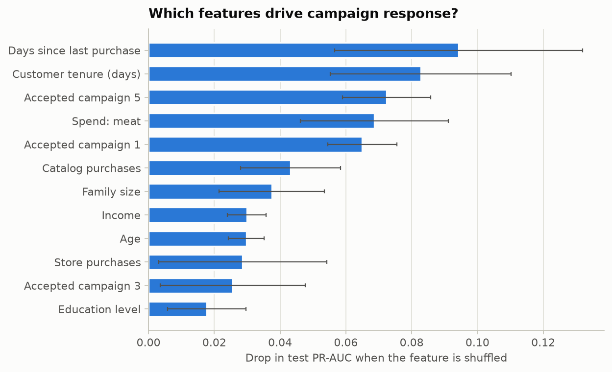

### Campaign-response classification

- **Target:** accepted the latest campaign (15.2% of customers), so always predicting 'no' already scores 84.9% accuracy - models are compared on ROC-AUC / PR-AUC instead.
- **Split:** 1641 train / 411 test (stratified), 5-fold stratified cross-validation on the training set.
- **Best model (by CV PR-AUC): Gradient Boosting**

| Model | CV ROC-AUC | +/- | CV PR-AUC | +/-  | CV F1 |
| --- | --- | --- | --- | --- | --- |
| Gradient Boosting | 0.892 | 0.024 | 0.640 | 0.009 | 0.578 |
| Logistic Regression | 0.894 | 0.019 | 0.628 | 0.073 | 0.581 |
| Random Forest | 0.879 | 0.019 | 0.588 | 0.039 | 0.466 |

Held-out test performance of Gradient Boosting:

| Threshold | Accuracy | Precision | Recall | F1 | ROC-AUC | PR-AUC |
| --- | --- | --- | --- | --- | --- | --- |
| 0.50 (default) | 0.835 | 0.466 | 0.661 | 0.547 | 0.884 | 0.593 |
| 0.59 (F1-tuned on train CV) | 0.849 | 0.500 | 0.613 | 0.551 | 0.884 | 0.593 |

Most influential features (permutation importance): Days since last purchase, Customer tenure (days), Accepted campaign 5, Spend: meat, Accepted campaign 1.

