# Results

### Data cleaning

| Step | Rows |
| --- | --- |
| Raw rows | 2,240 |
| Duplicate customers removed (identical except ID) | 184 |
| Missing income values imputed (education-group median) | 24 |
| Impossible ages removed (> 100 years) | 3 |
| Income outliers removed (> 165,993, Q3 + 3xIQR) | 1 |
| Marital-status oddities recoded to 'Single' (Alone / Absurd / YOLO) | 7 |
| **Clean rows** | 2,052 |

Engineered features: `age`, `tenure_days`, `total_spend`, `total_purchases`, `children`, `family_size`, `is_parent`, `campaigns_accepted`, `avg_spend_per_purchase`, `education_level`, `living_with`. Age and tenure are measured at the dataset snapshot date (2014-06-30).

### Exploratory analysis

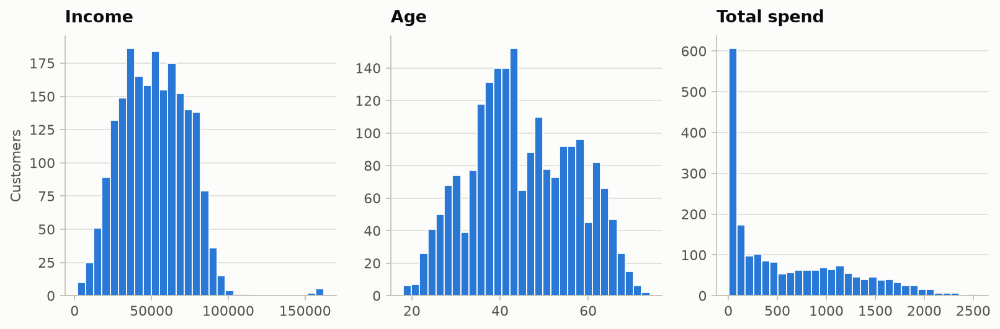

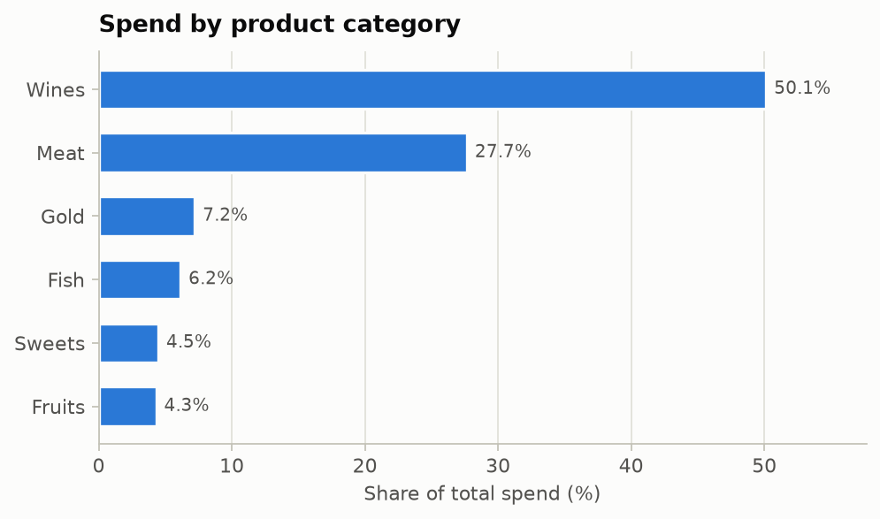

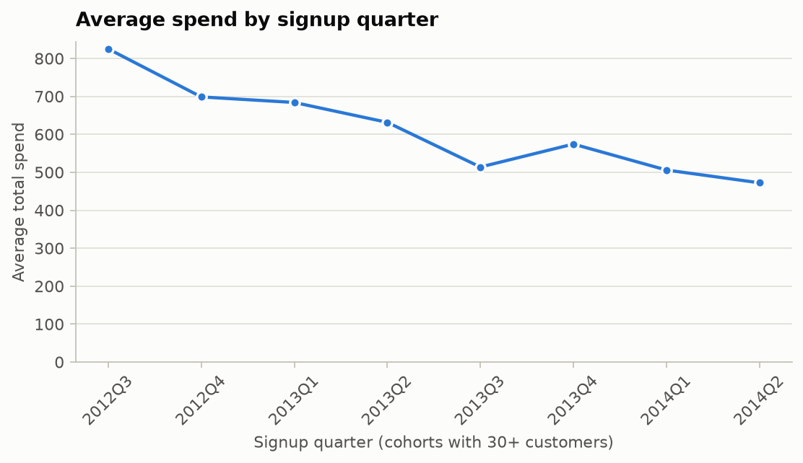

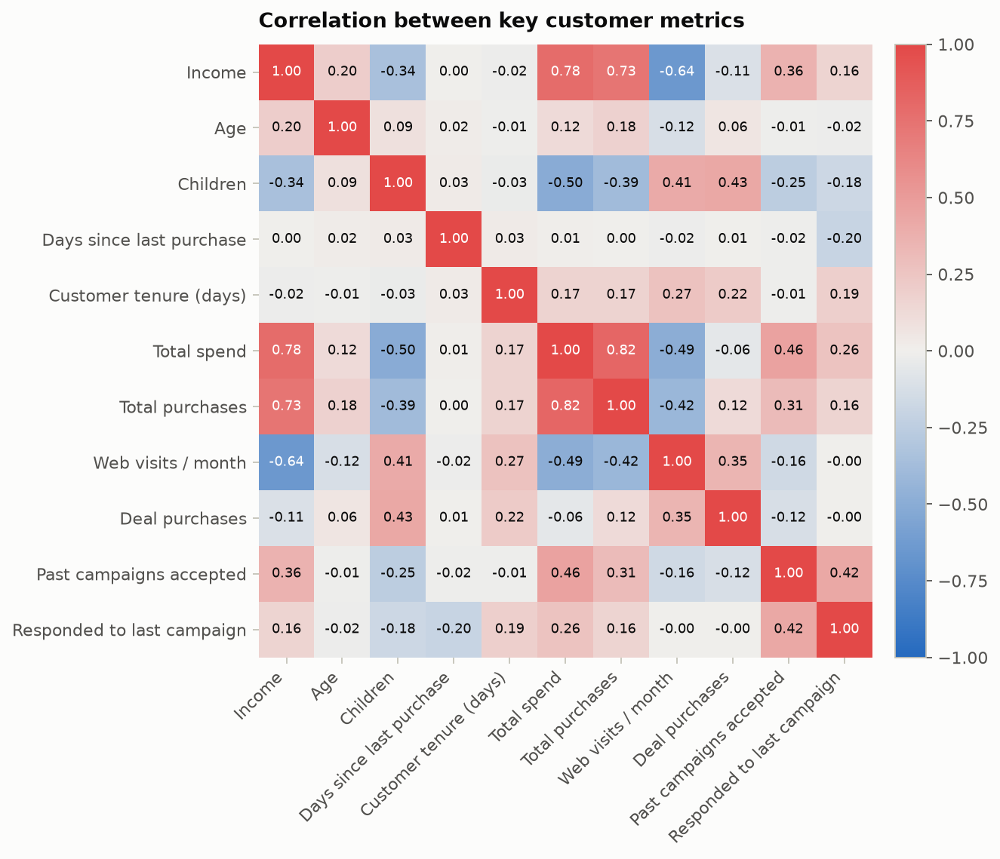

### Customer segmentation (K-Means)

- **Features:** income, age, children, total spend, total purchases, web visits / month, deal purchases, catalog purchases (skewed spend features log-transformed, then standardised)
- **k = 3**, chosen by silhouette score among k = 3-6 (elbow chart below)
- **Silhouette 0.299**, Davies-Bouldin 1.237, run-to-run stability (adjusted Rand index over 8 seeds) 0.983

| segment | Income | Age | Children | Total spend | Total purchases | Web visits / month | Deal purchases | Catalog purchases | customers |
| --- | --- | --- | --- | --- | --- | --- | --- | --- | --- |
| Segment 0 - Premium, few kids | 74,973 | 46.4 | 0.2 | 1,257.6 | 18.9 | 2.8 | 1.2 | 5.5 | 604 |
| Segment 1 - Mid-range, parents | 55,643 | 48.5 | 1.3 | 683.9 | 16.0 | 6.1 | 4.1 | 2.9 | 617 |
| Segment 2 - Budget, parents | 32,730 | 41.7 | 1.2 | 76.5 | 5.4 | 6.6 | 1.9 | 0.4 | 831 |

Algorithm cross-check at the same k:

| algorithm | silhouette | agreement_with_kmeans (ARI) |
| --- | --- | --- |
| K-Means | 0.299 | 1.000 |
| Agglomerative (Ward) | 0.271 | 0.703 |
| Gaussian Mixture | 0.261 | 0.670 |

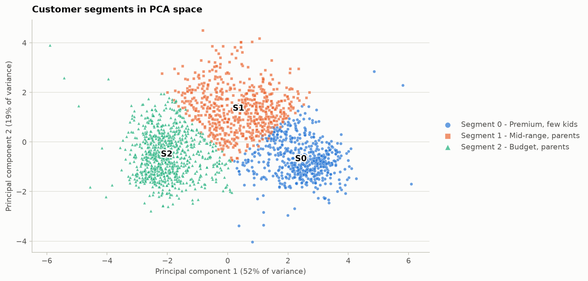

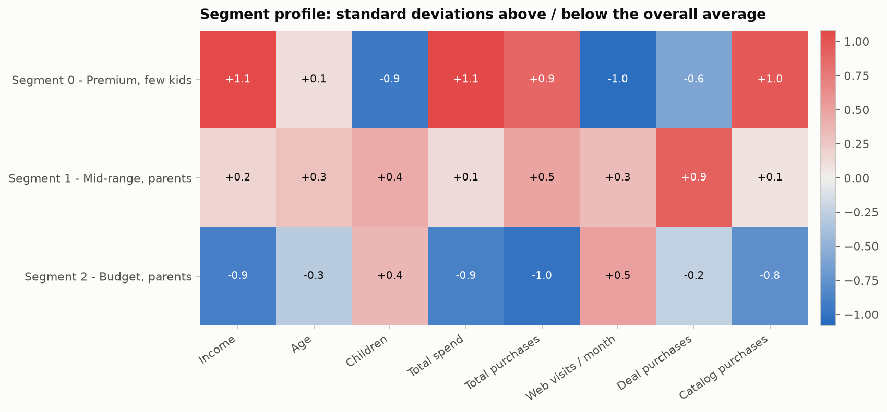

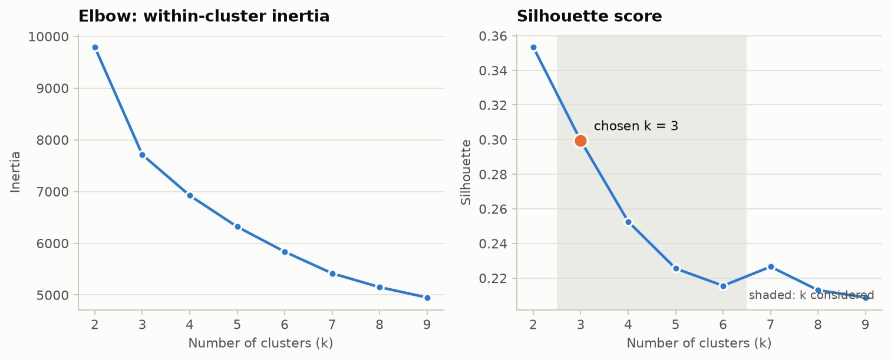

### SQL analysis (SQLite)

13 queries in [`sql/analysis.sql`](../sql/analysis.sql) use joins, CTEs, CASE bucketing, window functions (`NTILE`, `PERCENT_RANK`, running `SUM`) and sub-queries. Full output: `reports/sql_report.md`.

- The top 10% of customers by spend generate **30.3%** of total spend.
- **Segment 0 - Premium, few kids** is the highest-spending segment: 29.4% of customers but 61.0% of total spend.
- **Segment 0 - Premium, few kids** responds best to the latest campaign (25.0% vs 15.2% overall).
- Customers who accepted at least one earlier campaign respond at 40.7%, versus 8.4% for those who never did.
- 202 top-quartile spenders have not purchased in 60+ days (about 302,423 in historical spend) - prime retention targets.

| segment | customers | % customers | avg income | avg age | avg children | avg spend | % of total spend | response rate % |
| --- | --- | --- | --- | --- | --- | --- | --- | --- |
| Segment 0 - Premium, few kids | 604 | 29.4 | 74,973.0 | 46.4 | 0.2 | 1,257.6 | 61.0 | 25.0 |
| Segment 1 - Mid-range, parents | 617 | 30.1 | 55,643.0 | 48.5 | 1.3 | 683.9 | 33.9 | 14.1 |
| Segment 2 - Budget, parents | 831 | 40.5 | 32,730.0 | 41.7 | 1.2 | 76.5 | 5.1 | 8.9 |

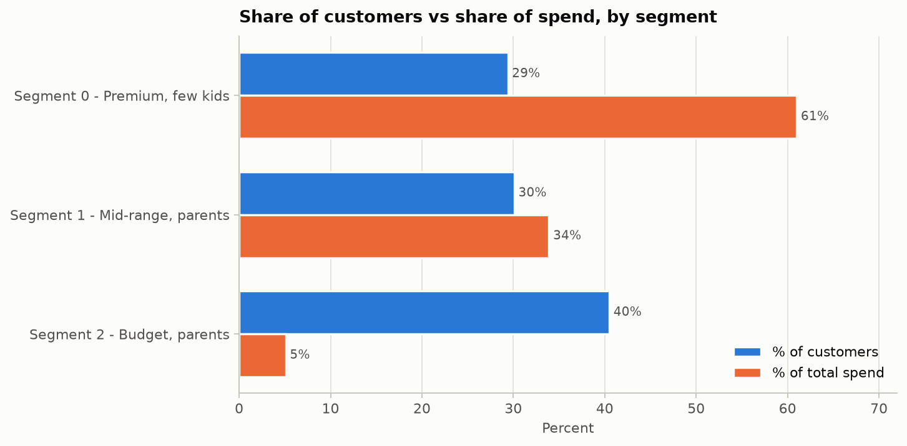

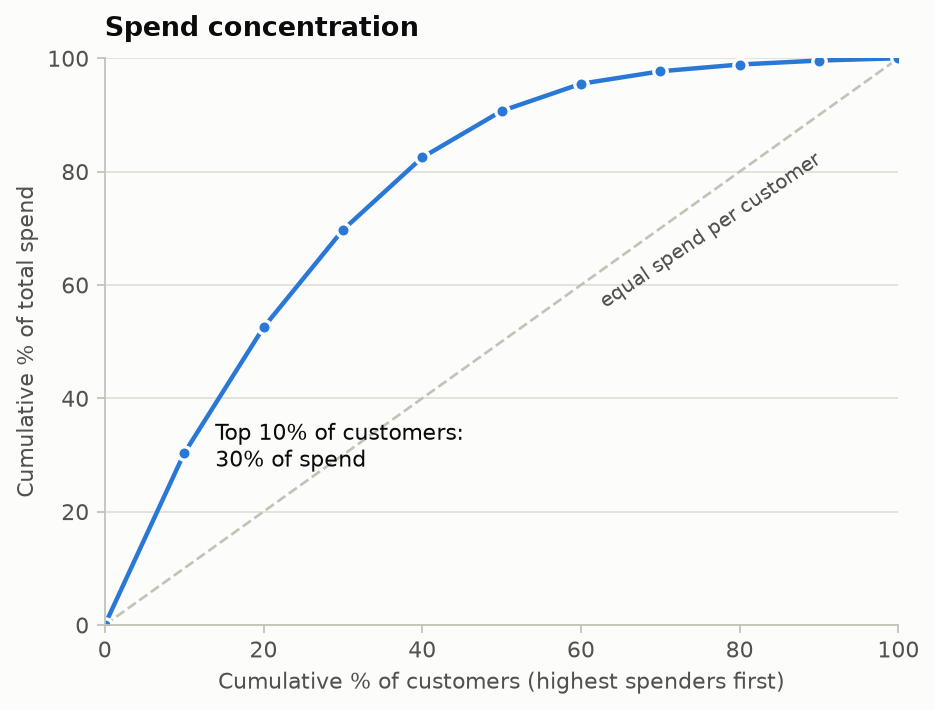

### Campaign-response classification

- **Target:** accepted the latest campaign (15.2% of customers), so always predicting 'no' already scores 84.9% accuracy - models are compared on ROC-AUC / PR-AUC instead.
- **Split:** 1641 train / 411 test (stratified), 5-fold stratified cross-validation on the training set.
- **Best model (by CV PR-AUC): Gradient Boosting**

| Model | CV ROC-AUC | +/- | CV PR-AUC | +/-  | CV F1 |
| --- | --- | --- | --- | --- | --- |
| Gradient Boosting | 0.892 | 0.024 | 0.640 | 0.009 | 0.578 |
| Logistic Regression | 0.894 | 0.019 | 0.628 | 0.073 | 0.581 |
| Random Forest | 0.879 | 0.019 | 0.588 | 0.039 | 0.466 |

Held-out test performance of Gradient Boosting:

| Threshold | Accuracy | Precision | Recall | F1 | ROC-AUC | PR-AUC |
| --- | --- | --- | --- | --- | --- | --- |
| 0.50 (default) | 0.835 | 0.466 | 0.661 | 0.547 | 0.884 | 0.593 |
| 0.59 (F1-tuned on train CV) | 0.849 | 0.500 | 0.613 | 0.551 | 0.884 | 0.593 |

Most influential features (permutation importance): Days since last purchase, Customer tenure (days), Accepted campaign 5, Spend: meat, Accepted campaign 1.

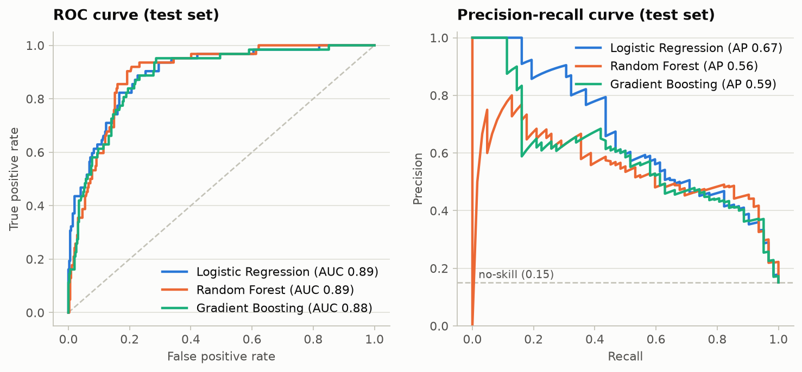

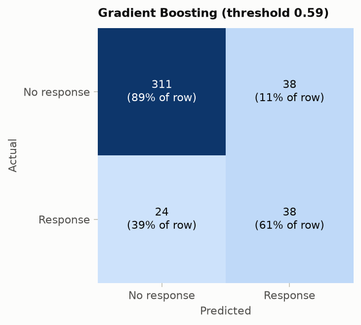

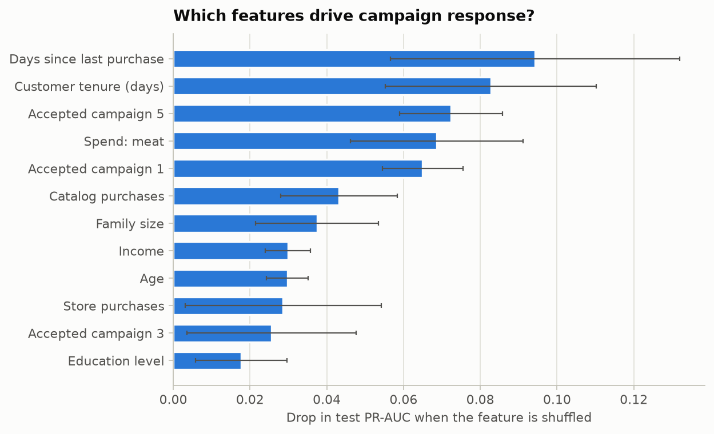
