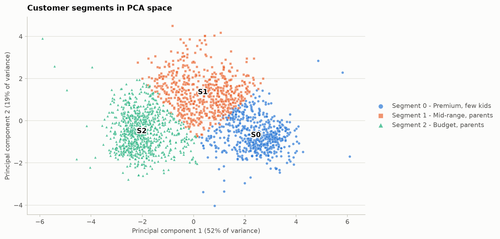
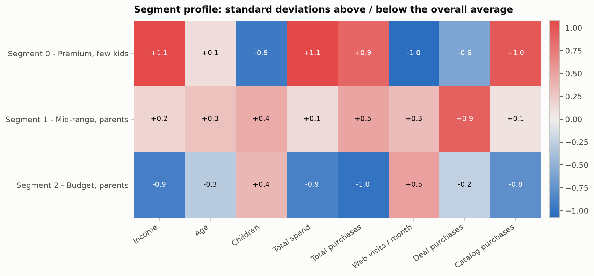
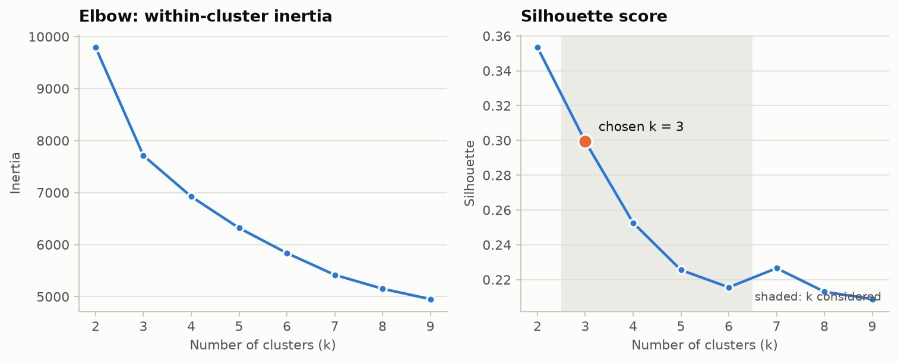

### Customer segmentation (K-Means)

- **Features:** income, age, children, total spend, total purchases, web visits / month, deal purchases, catalog purchases (skewed spend features log-transformed, then standardised)
- **k = 3**, chosen by silhouette score among k = 3-6 (elbow chart below)
- **Silhouette 0.299**, Davies-Bouldin 1.237, run-to-run stability (adjusted Rand index over 8 seeds) 0.983

| segment | Income | Age | Children | Total spend | Total purchases | Web visits / month | Deal purchases | Catalog purchases | customers |
| --- | --- | --- | --- | --- | --- | --- | --- | --- | --- |
| Segment 0 - Premium, few kids | 74,973 | 46.4 | 0.2 | 1,257.6 | 18.9 | 2.8 | 1.2 | 5.5 | 604 |
| Segment 1 - Mid-range, parents | 55,643 | 48.5 | 1.3 | 683.9 | 16.0 | 6.1 | 4.1 | 2.9 | 617 |
| Segment 2 - Budget, parents | 32,730 | 41.7 | 1.2 | 76.5 | 5.4 | 6.6 | 1.9 | 0.4 | 831 |

Algorithm cross-check at the same k:

| algorithm | silhouette | agreement_with_kmeans (ARI) |
| --- | --- | --- |
| K-Means | 0.299 | 1.000 |
| Agglomerative (Ward) | 0.271 | 0.703 |
| Gaussian Mixture | 0.261 | 0.670 |

